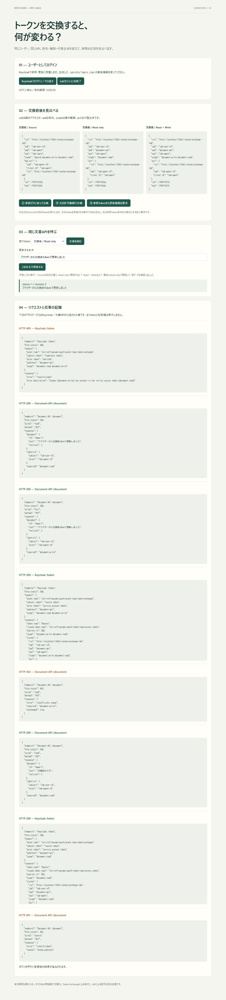

# ユーザーのTokenを、そのままAPIへ渡していいのか――Token Exchangeを手で試す

ユーザーがログインし、アプリケーションがその人の代わりに別のAPIを呼ぶ。AI Agentにも、普通のWebバックエンドにもある構成です。

ここで困るのは、ログインできたという事実だけでは、下流APIで何を許可してよいか決まらないことです。アプリ向けのTokenをそのまま転送すると宛先が違う。サービス自身のTokenだけで呼ぶと、誰の依頼なのかが抜け落ちる。ユーザーに許可された全権限を毎回持ち歩かせる必要があるかも考えたい。

今回はこの問題を、Tokenを交換する前後の差と、APIの成功・失敗から観察します。ブラウザーに入力した文章が本当に保存されたかまで確かめます。

## Token Exchangeはもともと何のための仕様か

[RFC 8693](https://www.rfc-editor.org/rfc/rfc8693.html)は、OAuthの認可サーバーにセキュリティTokenを提示し、別のTokenの発行を要求するSTSのプロトコルです。AI専用の仕様ではなく、impersonationやdelegationも扱います。交換時に宛先やscopeを要求でき、委任では代理元と実際に動く主体を区別できます。

ただし交換要求の標準化と、誰に何を許可するかの合意は別です。Token Exchangeを導入しただけで、サービス間の信頼や業務操作の意味が決まるわけではありません。

今回の題材は「aliceのメモをAgentが読む／更新する」です。AgentはLLMを持たない小さなWebサーバーで、Token交換とAPI呼び出しの役割だけを担います。

## 準備：三つのサービスを起動する

[README](../README.md#起動)の起動手順を実行してください。必要なのはDocker、Compose v2、Git、curl、ブラウザーです。ChatGPTアカウントや有料APIは使いません。

KeycloakがログインとToken発行、Lab Webが操作画面と交換要求、Document APIが文書の参照・更新を担当します。資格情報は起動時にランダム生成されます。

ブラウザーで `http://localhost:19360/` を開き、生成されたaliceの資格情報でログインします。Keycloakで参照・更新scopeへの同意を行うと、画面にSource Tokenのクレームが現れます。

## まず失敗させる：ログインしたのに読めない

「使うToken」をSourceにして「文書を読む」を押します。実測結果は **401 / wrong_audience** でした。

Sourceの`aud`は`lab-agent`です。文書APIは自分宛ての`document-api`を要求するため拒否します。ここで確認したいのは、Tokenが正しく発行されていても、そのTokenを使える場所には境界があることです。

## 交換して差分を見る：誰が、誰の代わりに、どこで、何をするか

「① 参照だけに絞って交換」を押します。WebはSourceを`subject_token`、自身のservice account Tokenを`actor_token`としてKeycloakに提示します。要求する宛先は`document-api`、scopeは`document.read`です。

実測では、交換後Tokenの`sub`はaliceを表す`lab-user-id`のまま、`aud`は`document-api`、scopeは`document.read`になりました。さらに`act.sub`に`lab-agent-id`が現れます。ユーザーと代理で動く主体を分けて読めます。

今回の`may_act`は、管理者が固定mapperで設定した「このAgentを代理主体として認める」という入力です。交換後の`act`は代理主体の記録です。画面でscopeに同意したことと、自由に代理先を選べる委任UIを実装したことは同じではありません。

## 参照だけのTokenで書いてみる

Read only Tokenを選ぶと、参照は **200**。本文とrevisionが返ります。次に自分の言葉を入力して更新すると **403 / insufficient_scope**。再読しても本文とrevisionは変わりませんでした。

この拒否を返したのは文書APIです。APIは署名、issuer、宛先、期限、subject、actor、scopeを確認してから変更します。Tokenを発行するKeycloakだけで完結する実験ではありません。

続いて「② 元の許可範囲で交換」を押し、Read + Write Tokenで同じ本文を更新します。今度は **200**でrevisionが増えました。Read only Tokenに戻して読み直すと、入力した文章が返りました。

これで、HTTP成功表示だけでなく成果データも確認できました。Read only Tokenが昇格したのではなく、元のSourceから別のTokenを得ています。

## 参照Tokenそのものから権限を増やせるか

「③ 参照Tokenから更新権限を要求」を押すと、今度は参照専用Tokenを交換元にしてread/writeを要求します。この比較ではactor Tokenを省き、同じクライアントによる通常の再交換を行います。

実測はKeycloakの **400 / invalid_scope**。「元のTokenにdocument.writeがない」という応答でした。先ほどの403と違い、APIを呼ぶ前の発行段階で拒否されています。

これは教材で設定した`downscope-assertion-grant-enforcer`の効果です。プロトコル名だけから「交換は必ず権限を狭める」と結論づけないことが大切です。

## 今回、解けたことと残る前提

実験では、Tokenの宛先を下流API向けにし、ユーザーと代理主体を区別し、参照だけの権限でAPIを呼べました。また、発行時の拒否と実行時の拒否を別々に観察できました。

一方で`document.read`とGET、`document.write`とPUTの対応は教材側で定義しています。Token Exchangeはこの意味合わせを消しません。今回は一つのrealm、一人のユーザー、一つのAgent、一件の文書です。Cross-tenantでの信頼伝播、動的な委任先、Agentのライフサイクル、LLMが適切なToolを選ぶかは未検証です。

[Keycloakの公式説明](https://www.keycloak.org/securing-apps/token-exchange)ではStandard Token ExchangeとLegacyを区別しています。この教材は26.8.1のStandardを使い、actor付き委任にはPreview機能を追加しています。一般的な交換と、今回の委任構成の成熟度を混同しないようにします。

次にAgentへ組み込むなら、この実験のどこでsubject、actor、audience、scopeを決めるかを追えます。LLMがどのToolを選んでも、実際に資源を変更する手前のAPIがTokenを検査する、という境界を具体的なコードで確認できる教材になっています。

再現手順は[README](../README.md)、実測範囲と環境は[検証記録](../VALIDATION.md)にまとめています。
